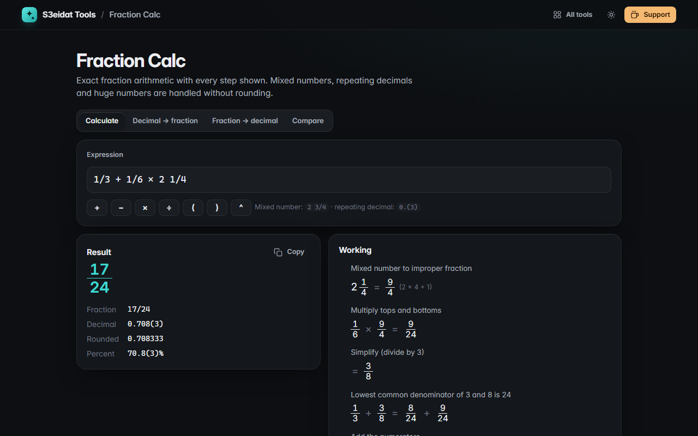

# Fraction Calc

> Exact fractions, mixed numbers and repeating decimals, with every step shown. Free, private, and it runs entirely in your browser.

### ▶ [Open Fraction Calc](https://s3eidat.github.io/fraction-calc/)



## Features

- **Calculate** expressions with fractions, mixed numbers (`2 3/4`), whole numbers and decimals: `+ − × ÷`, brackets and whole-number powers
- **Exact** arithmetic with BigInt: no rounding, however large the numbers get
- **Working steps**: mixed numbers to improper fractions, lowest common denominator, multiplying by the reciprocal, simplifying by the GCD
- Results as a fraction, mixed number, exact decimal (repeating part in brackets, e.g. `0.(142857)`) and percent
- **Decimal → fraction**, including repeating decimals like `0.(3)` and `1.2(34)` with the algebra shown, and close fractions with small denominators (e.g. `355/113`)
- **Fraction → decimal and percent**, with why the decimal ends or repeats
- **Compare** any number of fractions, smallest to largest, over a common denominator

A fraction written as `3/4` is read as one number, so `1/2 ÷ 3/4 = 2/3`.

## Privacy

Nothing leaves your device. There is no server, no account, no analytics.
The page ships with a strict Content-Security-Policy (`connect-src 'self'`), so the browser
itself blocks any attempt to send data anywhere.

## Run it yourself

It's plain HTML, CSS and JavaScript with no build step:

```bash
git clone https://github.com/s3eidat/fraction-calc
cd fraction-calc
python -m http.server 8000
```

Then open http://localhost:8000.

## Support

If this saved you time, **[buy me a coffee ☕](https://s3eidat.github.io/coffee/)**. It keeps every tool free.

---

Part of **[S3eidat Tools](https://s3eidat.github.io/)**: 100+ free, private tools that run in your browser. MIT licensed.
